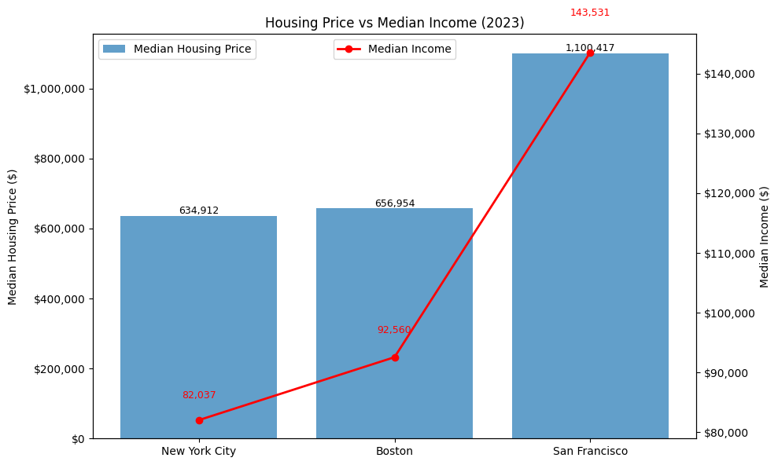
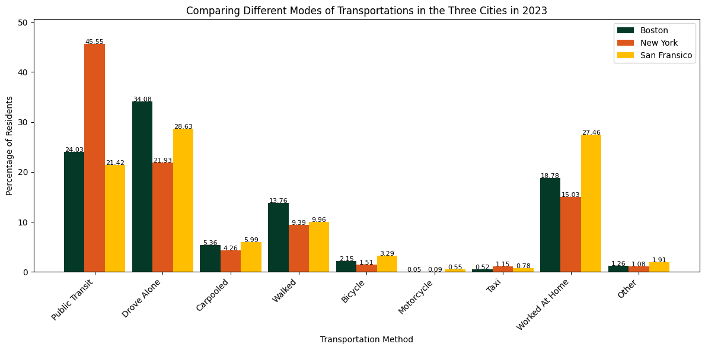
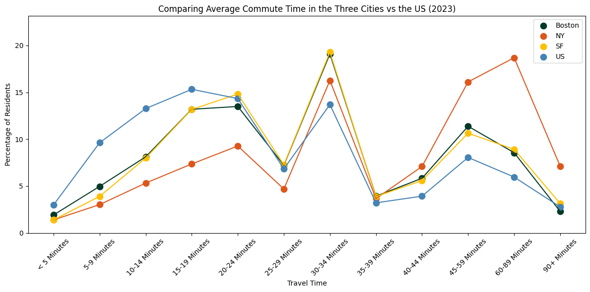
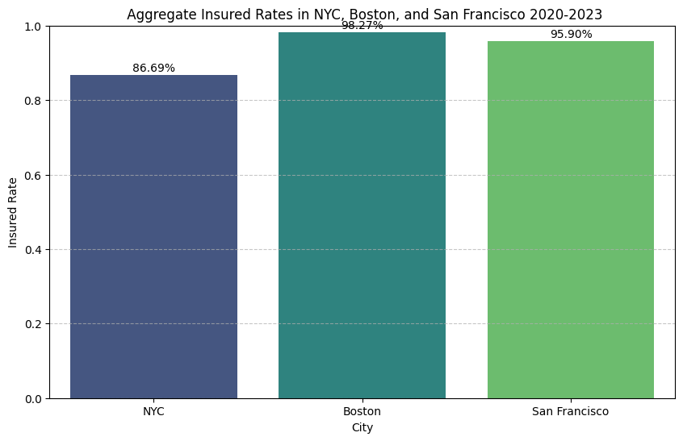
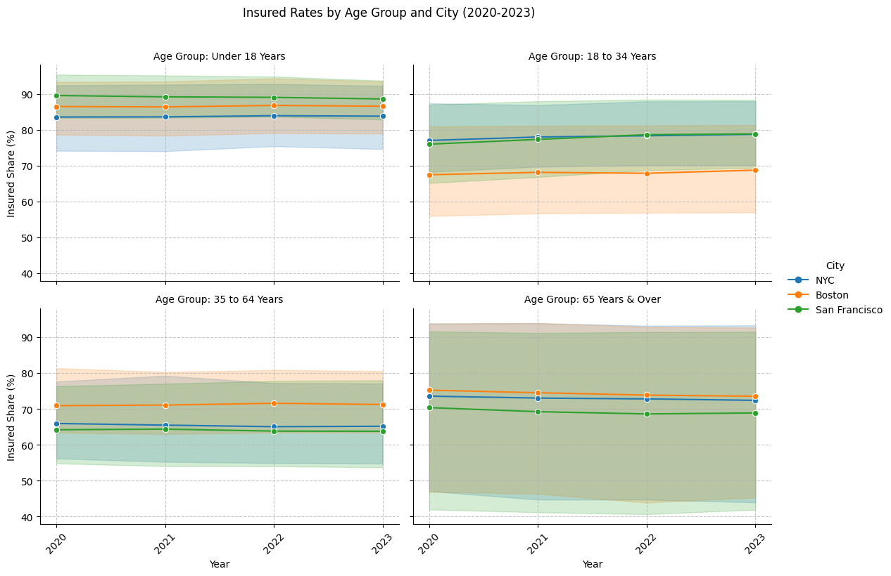
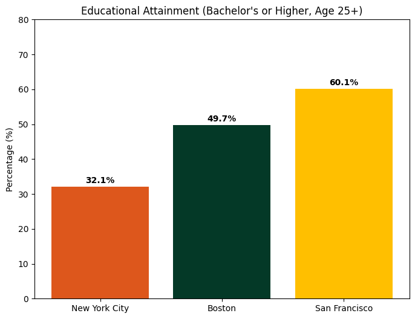

# Comparative Urban Quality of Life Analysis: NYC, Boston & San Francisco

An exploratory data analysis and data engineering pipeline evaluating quality-of-life trade-offs across New York City, Boston, and San Francisco across four core pillars: housing affordability, transit dynamics, health insurance coverage, and educational attainment.

**Course Project:** CIS 9650 (Programming for Analytics) | Zicklin School of Business, Baruch College 
**Team:** QUALITY SQUAD (Group 11)  
**Roles & Contributors:**
* **Christopher Chan** 
* **Eleni Asfaw**
* **Paolo Pagnozzi** 
* **Zhenfang Liu** 

**Deliverables:** [📄 Download Full Final Project Report (DOCX)](./CIS%209650%20Final%20Project%20Report.docx)

---

## 📌 Executive Summary

Metropolitan areas attract top-tier talent and capital, yet everyday living conditions vary significantly based on municipal geography, transit infrastructure, and economic structure. This project integrates multi-source census, civic, and real estate data to evaluate the trade-offs of living in three major U.S. economic hubs: **New York City, Boston, and San Francisco**.

Rather than relying on single aggregate livability rankings, we built a Python-driven data pipeline to normalize disparate datasets from **DataUSA, the U.S. Census Bureau (ACS), Zillow, and public health portals (Kaiser, CityHealth Dashboard, NYC EH Portal)**.

### 🔑 Key Comparative Findings (2023)

| Metric | New York City | Boston | San Francisco | Key Takeaway |
| :--- | :---: | :---: | :---: | :--- |
| **Median Home Price** | $634,912 | $656,954 | **$1,100,417** | SF homes cost 67% more than Boston/NYC. |
| **Median Household Income** | $82,037 | $92,560 | **$143,531** | SF incomes partially offset extreme housing prices. |
| **Price-to-Income Ratio** | **7.74x** | 7.10x | 7.67x | NYC and SF place the heaviest cost burden on residents. |
| **Public Transit Mode Share** | **45.55%** | 24.03% | 21.42% | NYC transit dependency is double its peer cities. |
| **Commutes >35 Minutes** | **>50%** | Moderate | Moderate | Geographic scale (>300 sq mi) drives long NYC commutes. |
| **Insured Population Rate** | 86.69% | **98.27%** | 95.90% | MA healthcare mandates drive near-universal coverage in Boston. |
| **Bachelor's Degree+ (25+)** | 32.10% | 49.70% | **60.10%** | SF leads in high-skill human capital concentration. |

---

## 🔍 Deep-Dive Findings & Visualizations

### 1. Housing Affordability vs. Median Income
* **Income-to-Price Divergence:** In all three cities, home prices significantly outstrip annual household earnings. 
* **The Affordability Squeeze:** While San Francisco records the highest nominal home price ($1,100,417), its high median income ($143,531) creates an income-to-price multiple (7.67x) comparable to NYC (7.74x), where lower median earnings ($82,037) collide with high urban real estate values. Boston offers the lowest multiple at 7.10x.

  

### 2. Commuter Mode Share & Travel Time Penalties
* **Transit Dominance vs. Remote Work:** NYC commuters rely predominantly on public transit (45.55%), whereas Boston leads in single-occupancy driving (34.08%) and walking/biking (15.91%). San Francisco leads in remote work adaptation at 27.46%.
* **Commute Duration Penalty:** NYC residents experience severe commute penalties: over 18% travel between 60–89 minutes daily, driven by the city’s vast geographic footprint (>300 sq. miles vs. Boston's 89.6 sq. miles and San Francisco's 46.89 sq. miles).

| Transportation Mode Share (2023) | Commute Time Distribution vs. National Benchmark |
| :---: | :---: |
|  |  |

### 3. Health Insurance Coverage Disparities (2020–2023)
* **Coverage Floor:** Boston maintains the highest aggregate insured rate at 98.27%, supported by robust state-level health mandates, followed by San Francisco at 95.90%. New York City trails at 86.69%.
* **Demographic Stability:** Coverage across all three cities remained remarkably stable across the 2020–2023 period, with minor variations driven primarily by public vs. private payer splits and specific age-bracket coverage gaps rather than macro annual shifts.

| Aggregate Insured Rates | Insured Coverage by Age Group Over Time |
| :---: | :---: |
|  |  |

### 4. Educational Attainment Polarization
* **Human Capital Concentration:** 60.1% of San Francisco adults (age 25+) hold a bachelor’s degree or higher, followed by Boston at 49.7%.
* **Borough Heterogeneity:** New York City’s population-weighted rate sits at 32.1%. While specific Manhattan neighborhoods mirror or exceed San Francisco levels, outer-borough demographics reflect a broader, more socio-economically diverse working-class base.

  

---

## 🛠️ Data Engineering & Methodological Challenges

1. **Scope Refinement (10 Cities $\rightarrow$ 3 Cities):**  
   Initial proposals targeted 10 metropolitan areas across 6 indicators. Data audits revealed severe temporal misalignments, disparate survey margins of error, and missing metrics in municipal open data portals. We refined the project scope to NYC, Boston, and San Francisco across 4 standardized indicators to ensure methodological integrity.
2. **Disparate Sourcing & Schema Alignment:**  
   Merged disparate data structures from the **U.S. Census Bureau ACS DP02**, **Zillow Home Value Index (ZHVI)**, and **Kaiser Family Foundation / CityHealth Dashboard**. Standardized reporting periods to 2020–2023 and harmonized geographic FIPS / NTA naming conventions.
3. **NYC Population-Weighted Averages:**  
   Because NYC educational and commute data were reported across disparate Neighborhood Tabulation Areas (NTAs) and five separate county/borough records, simple arithmetic means would skew results. We engineered population-weighted transformations to reflect true citywide aggregates for fair comparisons against Boston and San Francisco.
4. **Reshaping & Feature Engineering:**  
   Converted wide-format census matrices (e.g., 781 columns in ACS files) into long-format relational tables, computed relative mode shares, and engineered an `Insured Share` metric ($100 - \text{Uninsured}\%$) across age cohorts.

---

## 💻 Tech Stack & Tools

* **Core Language:** Python 3.x
* **Data Manipulation:** `pandas`, `numpy`
* **Visualization:** `matplotlib`, `seaborn`
* **Development Environment:** Google Colab, Jupyter Notebooks
* **Data Sources:** U.S. Census Bureau ACS (5-Year Estimates), DataUSA.io, Zillow Research (ZHVI), Kaiser Family Foundation, NYC Open Data

---

